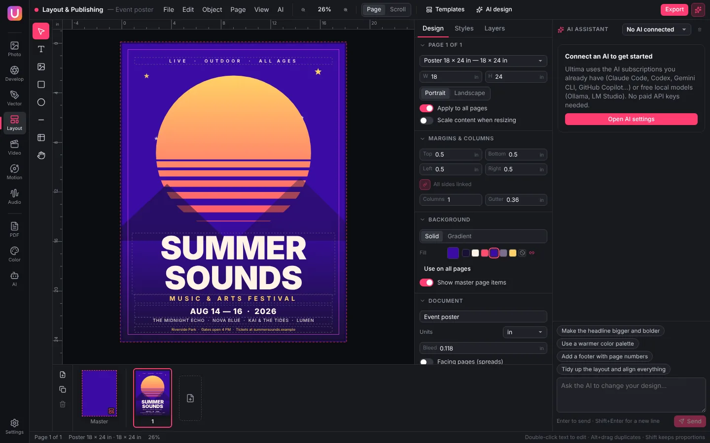

<div align="center">


# Ultima

**Every creative tool. One free app.**
A free, open-source, all-in-one creative suite for Windows, macOS and Linux — photo, develop, vector,
layout, video, motion graphics, audio and PDF — with AI from the subscriptions you already have,
or free local models. No API keys, no per-token bills.

[Download](#download) · [User guide](docs/USER_GUIDE.md) · [Connect your AI](docs/AI_SETUP.md) ·
[Install help](docs/INSTALL.md) · 🇮🇩 [Bahasa Indonesia](README.id.md)

[](https://github.com/tenmaryut/ultima/actions/workflows/ci.yml)
[](LICENSE)



</div>

## What's inside

| Tool | Covers the everyday work of | Highlights |
| --- | --- | --- |
| **Photo Editor** | Photoshop | Layers with blend modes and masks, selections (marquee, lasso, magic wand), brushes, clone & healing, text, adjustments (levels, curves, hue/saturation…), filters, PSD import/export |
| **Photo Develop** | Lightroom | Library with ratings and flags, non-destructive develop sliders (WebGL), tone curve, HSL, color grading, presets, batch export |
| **Vector Designer** | Illustrator | Pen and pencil tools, shapes, gradients, text, boolean operations, align/distribute, layers, SVG/PDF/PNG export |
| **Layout & Publishing** | InDesign, Adobe Express | Multi-page documents, master pages, paragraph styles, ready-made templates (posters, flyers, social posts, CV…), print-ready PDF |
| **Video Editor** | Premiere Pro | Multi-track timeline, trim/split/ripple, keyframes, speed curves, effects, color looks/LUTs/curves, masks, adjustment layers, sound effects and ducking, built-in SFX and stickers, titles, transitions, captions (SRT/VTT, automatic with Whisper), MP4/WebM export — and an AI that sees every clip and knows the beats |
| **Motion Graphics** | After Effects | Keyframes for transform, color, trim paths and more, easing curves, animation presets, text reveal, export to MP4/WebM/GIF/PNG sequence |
| **Audio Editor** | Audition | Waveform & spectrogram, effects (EQ, compressor, reverb…), noise reduction with noise print, recording, multitrack mixdown |
| **PDF Studio** | Acrobat | Read, search, merge, split, reorder, annotate, sign, redact, fill forms |
| **Color Studio** | Adobe Color | Harmony wheel, palettes from photos, contrast checker, color-blindness preview, ASE/GPL/CSS export |
| **AI Studio** | — | Chat with your AI, prompt templates for creators, compare two AIs, image generation, text to speech |

Ultima does not aim to clone every feature of every Adobe app — that's decades of work. It covers what most
people use every day, in one free app, and it is open for anyone to extend.

## AI without API bills

Every tool has an AI assistant you can talk to in your own words (*“make it warmer and add a title”*). Ultima
does not sell AI and never asks for an API key. Instead it uses:

- **the AI subscriptions you already have** — it starts the official command-line tool you installed and
  signed in to yourself (Claude Code, Codex, Antigravity CLI, Gemini CLI, GitHub Copilot CLI, Qwen Code, Cursor CLI, opencode,
  Kimi Code or any custom command), exactly as you would in a terminal; requests count against your own plan;
- **free local models** — Ollama, LM Studio, llama.cpp or Jan, completely offline.

Ultima never reads or stores your credentials and removes API-key variables before starting a tool, so nothing
is billed per token. Each tool runs under its vendor's terms — see [docs/AI_SETUP.md](docs/AI_SETUP.md),
including an important [note about Claude Code](docs/AI_SETUP.md#a-note-on-terms).

Images come from a free generator on your own computer (Stable Diffusion WebUI, ComfyUI or LocalAI), from the
built-in image tools of Antigravity CLI (Google AI Pro / Ultra) or Codex (ChatGPT plans), or as an SVG drawing by
any connected AI such as Claude. Text to speech (voice-overs in AI Studio, Video and Audio) uses
your system's voices or Piper, offline and free. Other optional helpers: Whisper (automatic captions and
transcripts), rembg (background removal) and FFmpeg (extra formats).

## Download

| System | File |
| --- | --- |
| Windows 10/11 | [Ultima-Setup-x64.exe](https://github.com/tenmaryut/ultima/releases/latest/download/Ultima-Setup-x64.exe) · [ARM64](https://github.com/tenmaryut/ultima/releases/latest/download/Ultima-Setup-arm64.exe) · [Portable](https://github.com/tenmaryut/ultima/releases/latest/download/Ultima-Portable-x64.exe) |
| macOS 12+ | [Apple Silicon](https://github.com/tenmaryut/ultima/releases/latest/download/Ultima-mac-arm64.dmg) · [Intel](https://github.com/tenmaryut/ultima/releases/latest/download/Ultima-mac-x64.dmg) |
| Linux | [AppImage](https://github.com/tenmaryut/ultima/releases/latest/download/Ultima-linux-x86_64.AppImage) · [.deb](https://github.com/tenmaryut/ultima/releases/latest/download/Ultima-linux-amd64.deb) · [.rpm](https://github.com/tenmaryut/ultima/releases/latest/download/Ultima-linux-x86_64.rpm) · [all files](https://github.com/tenmaryut/ultima/releases/latest) |
| Browser | [tenmaryut.github.io/ultima/app](https://tenmaryut.github.io/ultima/app/) (editors only; AI via local Ollama) |

The installers aren't code-signed yet, so Windows and macOS show a warning the first time — the
[install guide](docs/INSTALL.md) shows the two clicks needed. Release files are built by GitHub Actions from
this repository whenever a version tag is pushed.

## Build from source

```bash
git clone https://github.com/tenmaryut/ultima.git
cd ultima
npm install        # Node.js 22+
npm run dev        # run the desktop app with hot reload
npm run dist       # build installers for your OS into release/
npm run build:web  # browser version into dist-web/
```

Checks: `npm run typecheck` and `npm test`. See [docs/DEVELOPMENT.md](docs/DEVELOPMENT.md) for the
architecture and [CONTRIBUTING.md](CONTRIBUTING.md) to get involved.

## Documentation

| | English | Bahasa Indonesia |
| --- | --- | --- |
| Download & install | [docs/INSTALL.md](docs/INSTALL.md) | [docs/id/INSTALL.md](docs/id/INSTALL.md) |
| User guide | [docs/USER_GUIDE.md](docs/USER_GUIDE.md) | [docs/id/PANDUAN.md](docs/id/PANDUAN.md) |
| Connect your AI | [docs/AI_SETUP.md](docs/AI_SETUP.md) | [docs/id/AI_SETUP.md](docs/id/AI_SETUP.md) |
| Developer guide | [docs/DEVELOPMENT.md](docs/DEVELOPMENT.md) | [docs/id/PENGEMBANGAN.md](docs/id/PENGEMBANGAN.md) |

## Status

Version 0.1 — the first public release. Expect rough edges; please [report them](https://github.com/tenmaryut/ultima/issues).
Known limits: camera RAW files open through the JPEG preview stored inside them (no full RAW processing yet), HEIC
photos and scanned PDFs without a text layer (no OCR) aren't supported yet, CMYK color separation for print isn't
available, and H.264 export depends on what your system offers (WebM always works; FFmpeg adds MP4/MOV). Each tool's
own limits are listed in the [user guide](docs/USER_GUIDE.md).

## License & trademarks

[MIT](LICENSE) — free for personal and commercial use. Ultima is an independent project and is not affiliated
with or endorsed by Adobe, Anthropic, OpenAI, Google, GitHub, Microsoft or any other company mentioned.
Product names are trademarks of their owners and are used only to describe compatibility.
